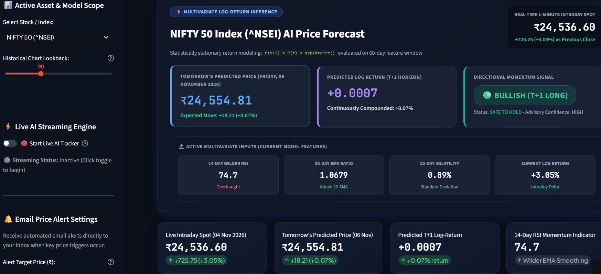

# Nifty 50 AI Forecasting Dashboard

[](https://www.python.org/)
[](https://streamlit.io/)
[](https://www.tensorflow.org/)
[](https://scikit-learn.org/)

An interactive data science portfolio project for exploring Nifty 50 market data and next-session price forecasts. The Streamlit dashboard combines historical price visualization, technical features, and an LSTM model in one place.

## Live Demo

### [Open the live Streamlit app](https://nifty50-stock-ai-ugyw3gkoffpaxbcyazosku.streamlit.app/)

## Dashboard Preview



## Key Features

- **Demo authentication gate:** Enter a username and password to access the dashboard. This is a portfolio demo gate only; it does not authenticate or authorize users.
- **Interactive visualizations:** Explore forecast and historical data through interactive Plotly charts and dashboard controls.
- **Market data retrieval:** Fetches current and historical Nifty 50 index data with `yfinance`, including intraday data where available.
- **Technical features:** Uses log returns, 14-period RSI, a 20-day simple moving average ratio, and 10-day volatility as model inputs.
- **Forecast and model metrics:** View predicted price trends, directional signals, and backtest metrics in the dashboard.
- **Portfolio scenarios:** Adjust holding and alert inputs to explore portfolio risk scenarios.

## Tech Stack

| Technology | Role |
| --- | --- |
| Python | Application and modeling code |
| Streamlit | Interactive dashboard and demo access gate |
| TensorFlow / Keras | LSTM sequence model |
| Scikit-learn | Feature and target scaling, evaluation metrics |
| yfinance | Historical and live market data retrieval |
| Pandas / NumPy | Data preparation and numerical computation |
| Plotly | Interactive charts |

## Machine Learning Architecture

The forecasting pipeline downloads Indian market history for the Nifty 50 index (`^NSEI`) with `yfinance`, engineers a multivariate feature sequence, and predicts the next session’s log return. The LSTM receives a 60-session lookback with four features: log return, RSI, the close-to-20-day-SMA ratio, and 10-day volatility. Its recurrent layers contain 64 and 32 units with dropout regularization.

The predicted return is converted back to a price estimate. Scalers are fit on the training partition and applied to held-out observations, helping prevent preprocessing leakage. Market forecasts are estimates from historical patterns and can differ substantially from actual prices.

## Run Locally

1. Clone the repository:

   ```bash
   git clone https://github.com/sidCodes6/nifty50-stock-ai.git
   cd nifty50-stock-ai
   ```

2. Create and activate a virtual environment.

   **Windows PowerShell:**

   ```powershell
   python -m venv .venv
   .\.venv\Scripts\Activate.ps1
   ```

   **macOS / Linux:**

   ```bash
   python -m venv .venv
   source .venv/bin/activate
   ```

3. Install dependencies:

   ```bash
   python -m pip install -r requirements.txt
   ```

4. Start the dashboard:

   ```bash
   python -m streamlit run app/dashboard.py
   ```

5. Open the local URL printed by Streamlit, usually `http://localhost:8501`.

## Disclaimer

Disclaimer: This application is purely for educational purposes and portfolio demonstration. The AI stock predictions are not financial advice and should not be used for actual market trading.
